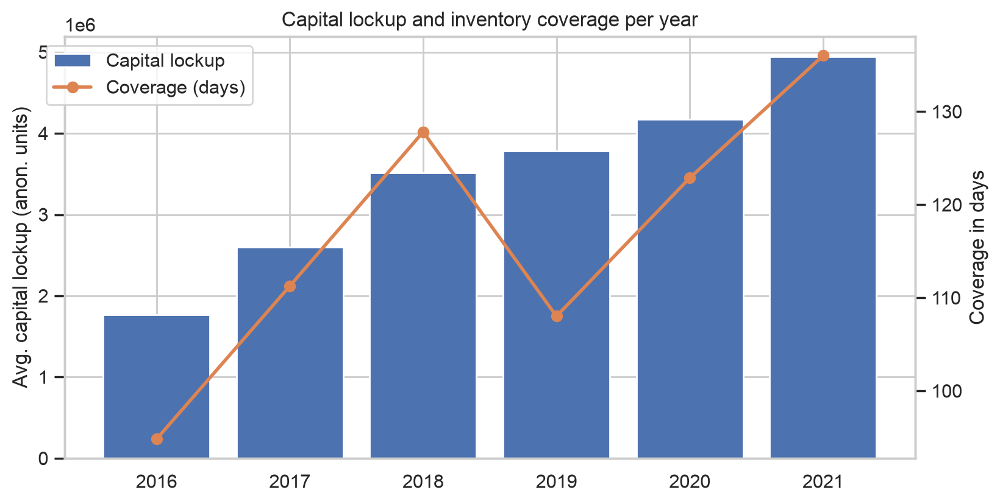
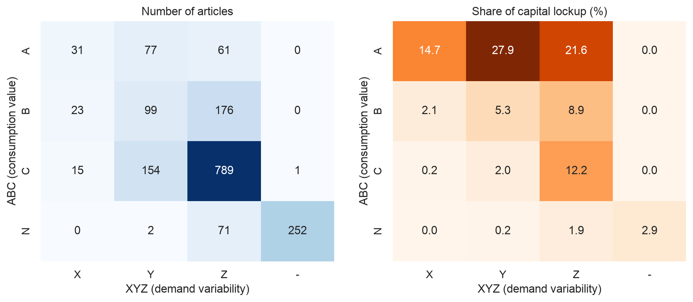
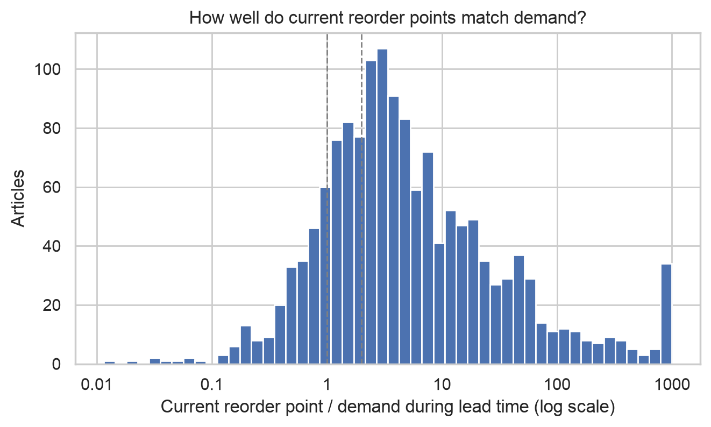
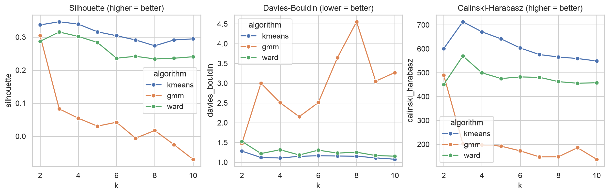
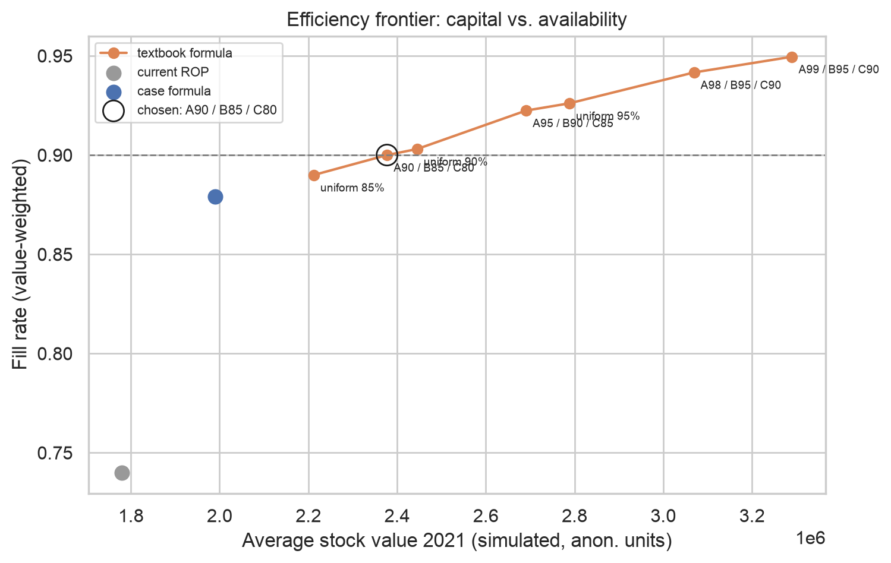
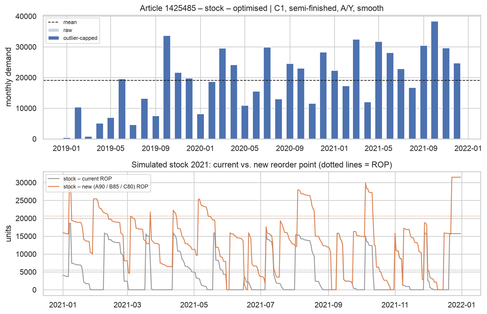
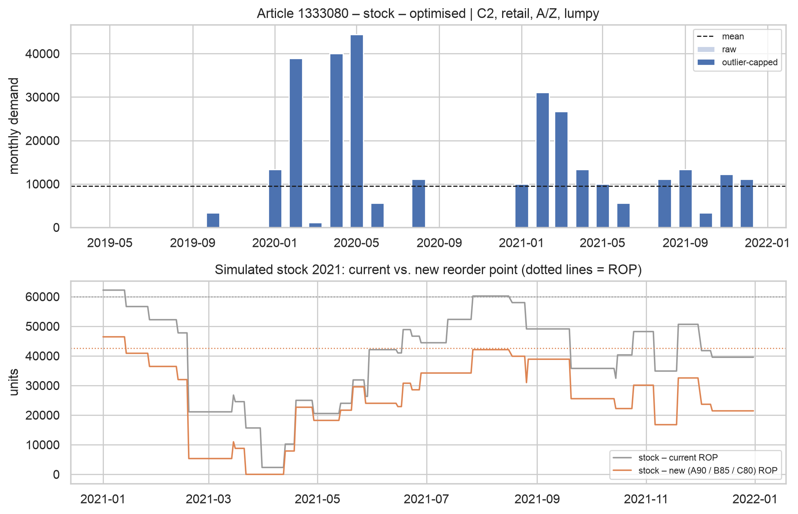
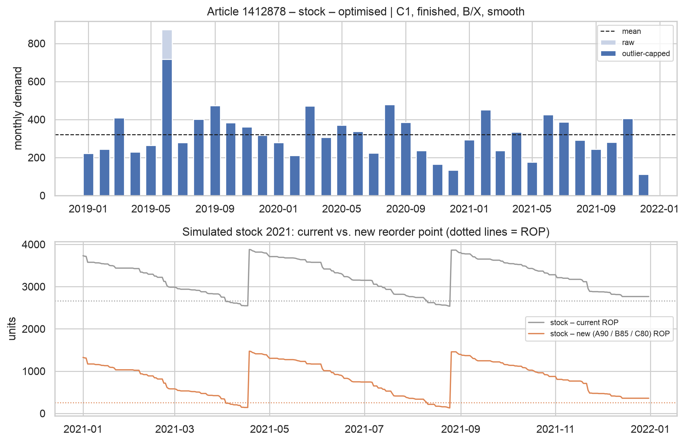
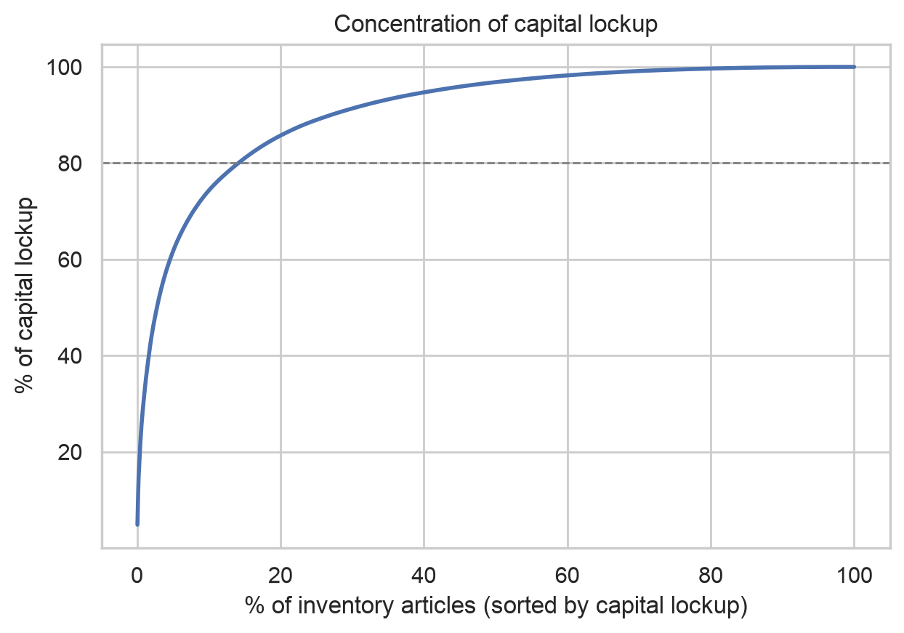
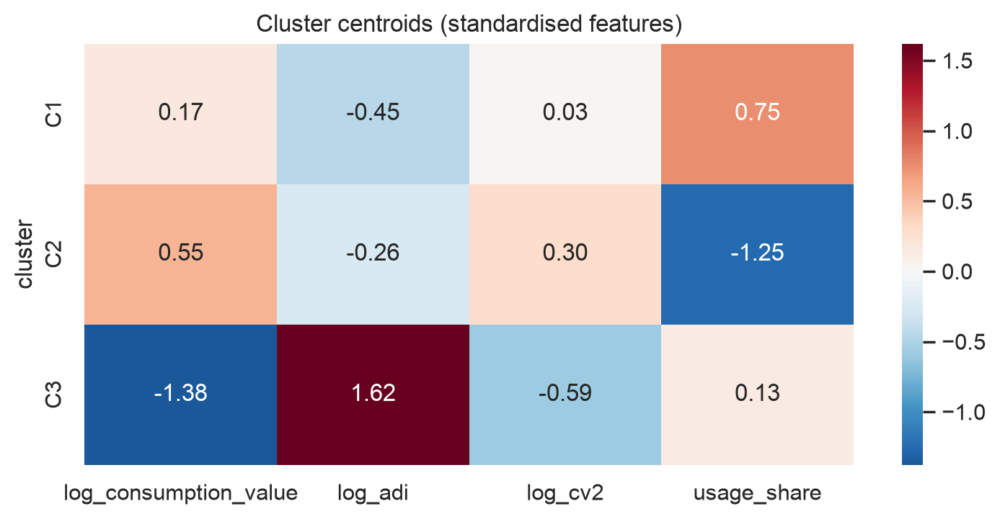

```{=typst}
#show table: set text(size: 8.5pt)
#show table: set par(justify: false)
#show figure.caption: set text(size: 9pt)
```



# Management summary

**Problem.** Since 2018 the company has deliberately built up inventory to secure availability during Covid-19 and the supply chain disruptions. For today's 1,751 stock articles, average capital lockup rose by 41% from 2018 to 2021, faster than consumption; coverage grew from 128 to 136 days.

**Approach.** Fifteen years of stock transactions (2.7 million records) were cleaned and analysed, the stock articles were classified with k-means clustering, and new safety stocks and reorder points were derived and tested in a day-by-day simulation of 2021 using real demand.

**Key findings.**

- **Capital is concentrated:** 10% of the stock articles hold 74% of the locked-up capital.
- **The excess comes from ordering behaviour, not from the reorder points.** Following the *current* reorder points with disciplined order sizes would require only 43% of today's stock value. Many reorder points are even too low: in the simulation they reach only a 74% fill rate. Availability is currently bought with excess stock.
- **Dead stock is a small lever** (about 5% of capital). The savings must come from the active articles.
- **Four article classes** emerge: production components (C1), sales articles (C2), sporadic slow movers (C3) and articles without demand (ND).

**Recommendations and effect.**

| Measure | Articles | Capital effect |
|------------------------------------------------------------|----------:|----------:|
| Keep C1 and C2 retail in stock with new safety stock / reorder points, order in disciplined quantities | 1,007 | −50% |
| Produce finished products of C2 to order | 210 | −100% |
| Order C3 on demand only, stop reordering | 281 | −100% |
| Phase out articles without demand (> 1 year old) | 182 | −100% |
| **Total** | **1,751** | **−55%** |

Capital lockup falls from 4.96 to 2.23 million (anonymised units), while the simulated fill rate *rises* from 74% to 90%. Reducing order quantities to one month of demand (MOQ renegotiation) would raise the reduction to about **−63%**. Because the data are anonymised, only relative figures are meaningful.

# Situation, goal and data

The company operates in the B2B business with about 80 employees in Switzerland and 100,000 articles. The procurement department maintains the master data and sets the safety stock, which the company uses as its **reorder point**: reordering starts when stock falls below it. Since 2018, inventory was increased on purpose, and according to the case description the capital lockup/revenue ratio rose by 9.33% from 2018 to 2022. **Goal:** reduce inventory capital lockup on the basis of past transaction data, via data analysis, article classification and optimised safety stock and reorder point levels.

**Dataset.** 2,694,849 transactions with 17 attributes for 58,764 articles. Each record contains date, article, transaction type, quantity, stock level and master data (purchase price, lead time, safety stock, minimum order quantity, product groups, supplier, e-shop flag). The case study definitions are used throughout:

- **Stock articles** are articles with safety stock > 0: **1,751 articles**.
- **Capital lockup** = average stock level of the period × purchase price.
- **Demand** = sales (type 1) + usage for production (type 5), net of returns. Procurement, production receipts, adjustments and internal transfers (which net to almost zero) are not demand.

# Data preparation

**Reference date.** Regular activity ends on **21 January 2022**. Later records consist only of a few monthly bookings on the 1st of each month (about 500–800 records each) and were removed.

**Master data are a snapshot.** Safety stock, lead time, price, MOQ and all groupings never change within an article; they are today's values copied onto every record. Historical reorder points are therefore unknown, and capital lockup is valued at today's purchase price.

**Outliers.** Only isolated one-off spikes were capped (more than 10× the article's median and no other transaction of comparable size). Recurring large orders, for example several sales of 26,000–56,000 units of article 1324850, are genuine B2B demand and were kept.

**Monthly demand 2019–2021.** For statistics, demand was aggregated per article and month over the last three full years, including zero months; months before an article's first transaction are excluded so that new articles are not penalised.

**Stock level series.** The stock field holds the level *before* each transaction. Within a day it is fully consistent, but 51% of day-to-day transitions show a jump, with positive and negative jumps cancelling out (likely different posting and value dates, or anonymisation). As a robustness check, stock was also rebuilt from cumulated quantities: yearly capital lockup differs by only −5% to +13% between both methods and the per-article correlation is 0.95. The reported levels are used because they give the *lower*, more conservative baseline.

# Data analysis

## Capital lockup over time

Without revenue data, capital lockup is related to the consumption value (demand × purchase price), expressed as coverage in days. Lockup grew from 3.5 million (2018) to 4.9 million (2021), coverage from 128 to 136 days (@fig-trend). Earlier years are understated, because only today's stock articles are included.

{#fig-trend width=78%}

## Concentration, product types and ABC

Capital is highly concentrated: the top **1%** of stock articles (18) hold **31%**, the top **10% hold 74%** and the top 20% hold 86% of the capital. The data contain no product-type field, but the transactions reveal it: articles received from own production are *finished* products, articles mainly consumed in production are *semi-finished*, the rest are *retail*.

| Product type | Articles | Capital share |
|---|---:|---:|
| Semi-finished | 854 | 49% |
| Retail | 369 | 36% |
| Finished | 314 | 12% |
| No demand (unclear) | 214 | 3% |

The ABC analysis (consumption value of the last 12 months) shows that 169 A articles generate 80% of the consumption value and hold 64% of the capital at 112 days of coverage, whereas 959 **C articles** hold 14% of the capital at **401 days** of coverage.

## Demand patterns and ABC-XYZ

Following Syntetos and Boylan, demand is classified by the average interval between months with demand (ADI) and the variability of demand sizes (CV²). Only 197 articles have *smooth* demand (the case study's "basic demand"), but they hold 37% of the capital; 901 articles have *intermittent* or *lumpy* demand ("searched demand"). The ABC-XYZ matrix (@fig-abcxyz) shows the classic candidates for not stocking: **789 CZ articles** (low value, irregular demand) holding 12% of the capital.

{#fig-abcxyz width=88%}

## Dead stock, lead times, reorder points and MOQ

**Dead stock is small.** 95% of the capital sits in articles sold or used within the last year. Only 107 articles had their last demand more than one year ago and 215 never had any; together they hold about 5% of the capital.

**Lead times look estimated, not measured.** Almost all are round standard values (30 days: 553 articles, 15: 381, 10: 226); 37 stock articles have none.

**Reorder points are poorly calibrated in both directions.** A reorder point should cover the demand during the lead time plus a buffer. @fig-rop compares the current reorder point with the lead-time demand: 441 articles are more than ten times too high, but 91 articles are *below half* of it, and these hold 23% of the capital. Their stock is therefore not driven by the reorder point but by order quantities: for **281 articles one minimum order covers more than twelve months of demand.**

{#fig-rop width=70%}

# Article classification

## Features and feature selection

The clustering should describe the *articles*, not the current policy that is being evaluated. Capital lockup, coverage, reorder point ratio and MOQ coverage are therefore not clustering inputs (this would be circular); they are used to profile the clusters afterwards. Lead time was also excluded: its few standard values would create artificial clusters, and it enters the safety stock formula instead.

Seven candidate features were built for the 1,498 articles with demand in 2019–2021 (log-transformed where skewed, standardised): consumption value, ADI, CV², CV, price, production share of demand, days since last demand. The 253 articles **without demand** form a rule-based class (ND), as their demand features are undefined.

Feature selection in two steps: (1) a correlation filter removed CV (r = 0.93 with ADI); (2) forward selection by silhouette score, starting from a domain core of *value, demand frequency and demand variability* (the dimensions of ABC and Syntetos–Boylan). It added the **production share**; recency did not improve the result. Final features: **consumption value, ADI, CV², production share.**

## Algorithm and evaluation

K-means, Gaussian mixture models and hierarchical clustering (Ward) were compared for k = 2 to 10 with three internal metrics (@fig-eval). **K-means with k = 3** is best on silhouette (0.346) and Calinski-Harabasz (713) and nearly best on Davies-Bouldin (1.12); Ward follows (0.315), the Gaussian mixture fails (0.08). A silhouette of 0.35 indicates moderate structure, which is realistic for continuous article characteristics. The classes are **very stable**: re-clustering random 80% samples reproduces them with an adjusted Rand index of 0.98 (minimum 0.95). They are not a re-labelling of ABC-XYZ (ARI ≈ 0) but combine the article's role (ARI with product type 0.45) with its demand behaviour.

{#fig-eval width=100%}

## Classes and strategies

| | C1 Production components | C2 Sales articles | C3 Sporadic slow movers | ND No demand |
|--------------------|----------------|------------------|----------------|----------------|
| Articles | 743 | 474 | 281 | 253 |
| Capital share | 53% | 39% | 5% | 3% |
| Typical article | semi-finished (89%) | retail 55%, finished 44% | semi-finished 64%, retail 28% | – |
| Months with demand (of 36) | 29 | 23 | 4 | 0 |
| Coverage of the class | 149 days | 109 days | **3,949 days** | – |
| Current ROP / lead-time demand | 3.3 | 2.3 | 38 | – |
| MOQ in months of demand | 3.9 | 1.7 | 54 | – |
| **Strategy** | **Stock, optimised** | **Retail: stock, optimised; finished: make-to-order** | **Order on demand** | **Phase out** (new: observe) |

**Which classes are taken on stock?** C1 and the retail articles of C2 (1,007 articles, 87% of the capital): production needs component availability, and retail customers expect delivery from stock. Within these, the **ABC class sets the service level**. **Finished products** of C2 can be manufactured quickly on site and are produced to order. **C3** has coverage of almost eleven years and MOQs worth 54 months of demand: no reordering, order on demand, sell down remaining stock. **ND articles** older than one year are phased out; 71 articles introduced within the last year are observed with unchanged settings.

# Safety stock and reorder point

## Formulas

The case study formula (with $\sigma$ = standard deviation of monthly demand, $D$ = annual demand, $L$ = lead time in days):

$$SS = \sigma \qquad ROP = \frac{D}{360}\cdot L + SS$$

and, if no lead time is maintained, $SS = ROP = \text{usage of the last 12 months} / 4$. This formula ignores the lead time and the target service level in the safety stock. As a comparison, the textbook formula with service-level factor $z$ was used:

$$SS = z \cdot \sigma \cdot \sqrt{L/30} \qquad ROP = \frac{D}{360}\cdot L + SS$$

The order quantity is $Q = \max(\text{MOQ}, \text{one month of demand})$, and the expected average stock is $SS + Q/2$.

## Evaluation by backtest simulation

Each policy was tested on the **real daily demand of 2021** for 925 stocked articles (all with demand history before 2021). Parameters were estimated on 2019–2020 only, so the test is out of sample. Continuous review: when the inventory position falls to the reorder point, $Q$ is ordered and arrives after the lead time; unmet demand is lost. All policies use the same $Q$, so differences come from the reorder point alone. Metrics: value-weighted **fill rate**, stockout days and average stock value.

Running the textbook formula at seven service-level settings gives an **efficiency frontier** (@fig-frontier). The selection rule was: *lowest capital with at least 90% fill rate*.

{#fig-frontier width=80%}

| Policy (backtest 2021) | Fill rate | Stock value |
|---|---:|---:|
| Current reorder points | 74.0% | 1.78 M |
| Case study formula | 87.9% | 1.99 M |
| Textbook, A 98% / B 95% / C 90% | 94.2% | 3.07 M |
| **Textbook, A 90% / B 85% / C 80% (chosen)** | **90.0%** | **2.38 M** |

Three results stand out. First, **ABC-differentiated service levels are efficient**: the chosen setting reaches practically the same fill rate as a uniform 90% (90.0% vs. 90.3%) with 3% less capital. Second, the simple **case formula performs surprisingly well** in aggregate, almost on the frontier, because $\sigma$ of monthly demand at the typical lead time of 30 days roughly equals a one-sigma buffer. Its weakness is structural: it over-protects articles with short lead times and under-protects those with long ones. The textbook formula is chosen because the service level becomes an explicit, adjustable management parameter; if 88% availability is acceptable, the case formula is the cheaper option. Third, the achieved fill rates of B and C articles stay below their nominal targets, because lumpy demand is not normally distributed.

## Total effect

| Strategy | Articles | Current capital | New capital | Change |
|---|---:|---:|---:|---:|
| Stock, optimised | 1,007 | 4.35 M | 2.18 M | −50% |
| Make-to-order | 210 | 0.23 M | 0 | −100% |
| Order on demand | 281 | 0.23 M | 0 | −100% |
| Phase out | 182 | 0.09 M | 0 | −100% |
| Observe (new) | 71 | 0.06 M | 0.06 M | 0% |
| **Total** | **1,751** | **4.96 M** | **2.23 M** | **−55%** |

The expected stock of the new policy (2.18 M) and the simulated stock (2.38 M on the simulated subset) agree well. For the simulated articles, actual capital lockup was 4.10 M, whereas the *current* reorder points with disciplined order sizes would need only 1.78 M: **57% of the stocked capital lies beyond what the reorder-point policy requires.** If order quantities were reduced to one month of demand, the stocked articles would need only 1.78 M instead of 2.18 M (total effect about −63%). The effects of removing articles from stock are realised as existing stock is consumed or sold.

# Recommendations for ten articles

The ten articles were chosen to cover all classes and the typical situations: the largest capital holders, steady and lumpy demand, an MOQ-driven article, an oversized reorder point, a missing lead time, and one article for each strategy without stock. Capital change compares expected new capital with the last 12 months; fill rates are from the 2021 backtest (current → new reorder point).

| Article | Situation | Strategy | Current ROP | New SS | New ROP | Capital | Fill rate |
|---------|------------------------------|----------------|--------:|--------:|--------:|---------:|--------------:|
| 1425485 | C1, A, smooth, largest capital | Stock | 5,553 | 10,478 | 23,255 | −80% | 64% → 93% |
| 1395542 | C2 retail, A, erratic | Stock | 13,328 | 16,953 | 35,218 | −18% | 52% → 89% |
| 1424728 | C1, A, smooth | Stock | 1,332 | 4,205 | 7,891 | −81% | 65% → 90% |
| 1333080 | C2 retail, A, lumpy | Stock | 59,980 | 23,409 | 42,500 | −71% | 100% → 91% |
| 1412878 | C1, B, ROP > 10× lead-time demand | Stock | 2,665 | 87 | 248 | −78% | 100% → 100% |
| 1423836 | C1, C, MOQ = 29 months of demand | Stock | 166 | 47 | 86 | −40% | 100% → 100% |
| 1420466 | C1, C, no lead time maintained | Stock | 11 | 2 | 4 | −26% | 100% → 100% |
| 1876926 | C2, finished, lumpy | Make-to-order | 111 | 0 | 0 | −100% | – |
| 1334543 | C3, MOQ = 28 months of demand | Order on demand | 13,328 | 0 | 0 | −100% | – |
| 1372564 | ND, no demand 2019–2021 | Phase out | 3,998 | 0 | 0 | −100% | – |

**1425485 – reorder point too low, stock far too high.** The largest capital holder: a production component with steady demand of about 19,000 units per month and a 20-day lead time. Its reorder point of 5,553 covers less than half of the lead-time demand (simulated fill rate 64%), yet average stock was about 100,000 units, more than five months of demand. **Recommendation:** raise the reorder point to 23,255 *and* order one month of demand per order; capital falls by 80% while availability rises to 93% (@fig-a1).

{#fig-a1 width=80%}

**1395542 – undersized retail article.** Erratic demand with a 60-day lead time. The current reorder point leads to frequent stockouts (52% fill rate). **Recommendation:** reorder point 35,218; this costs more safety stock but disciplined ordering still reduces capital by 18% while lifting availability to 89% – the only case among the ten where availability is the main gain.

**1424728 – steady demand.** Like 1425485, the reorder point (1,332) is far below the lead-time demand while stock is high. New reorder point 7,891, capital −81%, fill rate 65% → 90%.

**1333080 – lumpy "searched" demand.** Large irregular customer orders. The current reorder point of 59,980 guarantees 100% availability at high cost. The new reorder point of 42,500 cuts capital by 71% at a 91% fill rate. For such articles the normal-distribution safety stock is a weak fit; **coordinating large orders with customers** in advance is the better lever (@fig-a2).

{#fig-a2 width=80%}

**1412878 – heavily oversized reorder point.** Smooth demand of about 320 units per month and a 15-day lead time, but a reorder point of 2,665 (more than ten times the lead-time demand). **Recommendation:** reorder point 248 and order the MOQ of 1,332; capital −78% at a simulated fill rate of 100% (@fig-a3).

{#fig-a3 width=80%}

**1423836 – stock driven by the MOQ.** About 20 units monthly demand but a minimum order of 568 (29 months). Lowering the reorder point from 166 to 86 saves 40%; the real lever is **renegotiating the MOQ** or buying from the second supplier.

**1420466 – no lead time maintained.** A high-value finished article (price 125.9) with very low demand. The case study fallback (usage/4) gives a reorder point of 7; the textbook variant assumes 30 days and gives 4. **Recommendation:** reorder point 4 and, above all, maintain the real lead time.

**1876926 – finished product → make-to-order.** Lumpy demand of a product that can be manufactured quickly on site; no finished-goods stock is needed. **1334543 – C3 → order on demand.** Demand in only a few months, but the MOQ of 8,885 equals 28 months of demand; its stock of 8,985 units corresponds to about one minimum order. Stop reordering and procure per customer order. **1372564 – phase out.** No demand in 2019–2021, yet 16,896 units in stock and a reorder point of 3,998: set the reorder point to zero and sell down or write off.

# General recommendations

1. **Implement the class-based stocking policy.** Stock C1 and C2 retail, produce finished products to order, order C3 on demand, phase out ND – about **−55% capital lockup** at higher availability.
2. **Fix ordering behaviour, not only the parameters.** 57% of the stocked capital comes from ordering beyond the reorder-point policy. Order a defined quantity (e.g. one month of demand) when the reorder point is reached, and end the precautionary bulk buying of the Covid period.
3. **Renegotiate minimum order quantities.** For 281 articles one order covers more than a year of demand; reducing order sizes to one month is worth a further ~8 percentage points of capital.
4. **Set service levels by ABC class** (A 90%, B 85%, C 80% cycle service level) and treat them as an explicit management decision; the efficiency frontier shows the cost of every additional percentage point.
5. **Measure real lead times** from order and receipt dates instead of maintaining standard values, and maintain them for the 37 articles without.
6. **Plan searched demand with customers.** For lumpy B2B demand, agree on call-off orders or advance notice instead of holding large safety stocks.
7. **Recalculate regularly.** Rerun the classification and the safety stock calculation quarterly from the transaction data; monitor fill rate and coverage per class.

# Limitations and outlook

The data are **anonymised**: prices and quantities are scaled, so only relative results are interpretable. Master data are **today's snapshot**, so past capital lockup is valued at today's prices and historical reorder points are unknown. The stock series contains **day-level breaks**; the robustness check shows that the conclusions do not depend on them. The simulation uses an **assumed order quantity** and lost sales, and treats lead times as fixed; it compares policies fairly but does not reproduce the actual ordering history. The safety stock formulas assume **normally distributed demand**, which does not hold for lumpy articles. Finally, the 2021 test year still contains pandemic effects.

**Outlook:** demand forecasting per class (e.g. Croston's method for intermittent demand), stochastic lead times, an EOQ-based order quantity that includes ordering and holding costs, and a validation with the original, non-anonymised data.



# Appendix

## A. Method details

- **Reference date** 21.01.2022; demand window 2019-01 to 2021-12 (36 months); 360-day year as in the case formula.
- **Outlier rule:** demand transaction > 10× the article's median and no other transaction ≥ 50% of its size, at least 10 demand transactions; capped at max(10× median, second-largest transaction).
- **Product type:** finished = receives stock from own production; semi-finished = usage for production ≥ 50% of demand; retail = otherwise.
- **ABC:** cumulative consumption value of the last 12 months, A ≤ 80%, B ≤ 95%, C rest, N = no consumption.
- **Demand patterns:** smooth ADI < 1.32 and CV² < 0.49; erratic ADI < 1.32, CV² ≥ 0.49; intermittent ADI ≥ 1.32, CV² < 0.49; lumpy otherwise. XYZ on the CV of monthly demand: X < 0.5, Y < 1.0, Z ≥ 1.0.
- **Clustering:** standardised features, k-means (50 initialisations), k chosen in 3–8 by silhouette with every cluster ≥ 3% of the articles; stability by 30 bootstrap runs on 80% samples.
- **Simulation:** 2020 warm-up, 2021 evaluated; start stock = ROP + Q/2; order in multiples of Q until the inventory position exceeds the reorder point; lead time 30 days or group median where none is maintained.

## B. Additional figures

{width=55%}

{width=60%}

The complete recommendation for all 1,751 stock articles is provided in the accompanying file `05_recommendations.xlsx` (sheets: ten articles, all articles, capital effect, backtest, efficiency frontier).
